<!-- ═══════════════ HEADER ═══════════════ -->


 

<!-- ═══════════════ ABOUT (animated terminal) ═══════════════ -->
##  `whoami`


<!-- ═══════════════ QUICK BADGES ═══════════════ -->

<!-- ═══════════════ TECH STACK ═══════════════ -->
## ⚡ Tech Stack

**Languages** 

**Frontend** 

**Backend & Databases** 

**DevOps & Cloud** 

**Tools** 

<!-- ═══════════════ SKILL LEVELS ═══════════════ -->
## 📶 Skill Levels


<!-- ═══════════════ PROJECTS ═══════════════ -->
## 🛰️ Featured Builds

<a href="https://github.com/hitanshusince2004/Portfolio"></a>
<a href="https://github.com/hitanshusince2004/Health-Card-Portal"></a>
<a href="https://github.com/hitanshusince2004/My-internship-Music-Reccomandation---using-user-preferences-"></a>
<a href="https://github.com/hitanshusince2004/DevOps_01"></a>

## 🧪 More Projects

| Project | What it is | Stack |
|:--|:--|:--|
| 🌐 [**Portfolio**](https://github.com/hitanshusince2004/Portfolio) | My personal portfolio website | HTML |
| 🏥 [**Health Card Portal**](https://github.com/hitanshusince2004/Health-Card-Portal) | A web portal for managing digital health cards | HTML |
| 🎵 [**Music Recommendation**](https://github.com/hitanshusince2004/My-internship-Music-Reccomandation---using-user-preferences-) | Internship project: recommends music based on user preferences | HTML |
| ⚙️ [**DevOps_01**](https://github.com/hitanshusince2004/DevOps_01) · [**DevOpsExp5**](https://github.com/hitanshusince2004/DevOpsExp5) | Hands-on DevOps experiments and practicals | HTML |
| 📘 [**HTML-Repo**](https://github.com/hitanshusince2004/HTML-Repo-) | Every HTML syntax covered with working examples | HTML |

<!-- ═══════════════ STATS ═══════════════ -->
## 📡 GitHub Telemetry


<!-- ═══════════════ METRICS ═══════════════ -->
## 🔬 Developer Metrics

<!-- ═══════════════ 3D CONTRIB ═══════════════ -->
## 🧊 3D Contribution Skyline

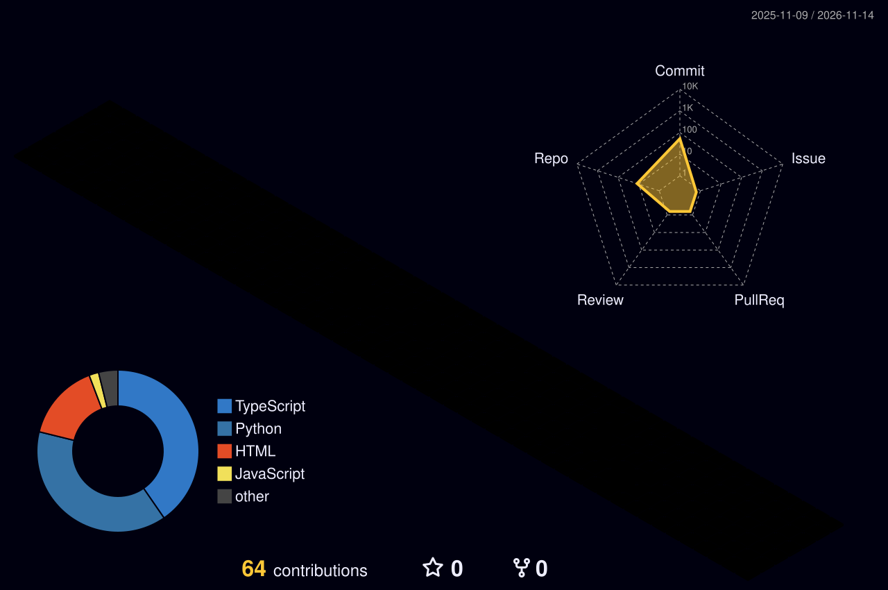

<!-- ═══════════════ ARCADE ═══════════════ -->
## 🕹️ Contribution Arcade

<picture>
  <source media="(prefers-color-scheme: dark)" srcset="https://raw.githubusercontent.com/hitanshusince2004/hitanshusince2004/output-pacman/pacman-contribution-graph-dark.svg" />
  <source media="(prefers-color-scheme: light)" srcset="https://raw.githubusercontent.com/hitanshusince2004/hitanshusince2004/output-pacman/pacman-contribution-graph.svg" />
  
</picture>

<picture>
  <source media="(prefers-color-scheme: dark)" srcset="https://raw.githubusercontent.com/hitanshusince2004/hitanshusince2004/output/github-contribution-grid-snake-dark.svg" />
  <source media="(prefers-color-scheme: light)" srcset="https://raw.githubusercontent.com/hitanshusince2004/hitanshusince2004/output/github-contribution-grid-snake.svg" />
  
</picture>

<!-- SPOTIFY IS OFF: after adding your UID, delete this line and the last line of this block (SETUP.md step 5)
## 🎧 Now Playing

-->

<!-- ═══════════════ QUOTE ═══════════════ -->
## 💬 Dev Quote

<!-- ═══════════════ FOOTER ═══════════════ -->

